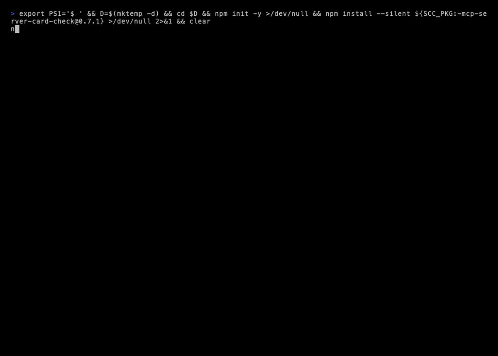

# Server Card Check

[](https://wolfe-jam.github.io/agent-business-card/?repo=Wolfe-Jam/mcp-server-card-check)

An independent checker for MCP Server Cards (SEP-2127). Paste a server's URL and see, rule by rule, what passes and what to fix.

**[Try it online](https://servercard.wolfejam.dev)** · [What it checks](#what-it-checks) · [Census](docs/reference.md)

```sh
npx mcp-server-card-check https://your-server.example.com/mcp
```



A **Server Card** is a small public file that tells MCP clients who a server is and how to connect, before they connect. [SEP-2127](https://github.com/modelcontextprotocol/modelcontextprotocol/pull/2127) made it Final on 2026-10-06. Every result here says MUST or SHOULD, pass or fail, why, and which section of the spec it comes from.

## What you can do

- **Check your server in the browser** at [servercard.wolfejam.dev](https://servercard.wolfejam.dev). Usually a few seconds; nothing to install.
- **Fail the build on a broken card:** add `npx mcp-server-card-check https://your-server/mcp` to CI. It exits 1 on any MUST failure.
- **Check a server before you trust it:** run it on someone else's endpoint before adding it to your client or catalog.
- **Compare the card with the live server:** add `--transport` to connect once and check that the server says what its card says.
- **Re-issue your catalog's identifiers for AI Catalog v0.9:** `migrate` rewrites `urn:air` ids that read differently in v0.9 and keeps the former id on each new entry.

## Did you know?

From a [census of every MCP Registry remote server](docs/reference.md) on 2026-10-12, six days after the spec merged:

- About **2%** publish a valid Server Card so far.
- **637 of the 3,609** endpoints that answer at `/server-card` return a web page, not a card. A 200 isn't a card.
- Only **6%** of cards send all the CORS headers browsers need to cache and refresh them.
- A card can pass the schema and still be wrong: invented protocol versions, or a name that doesn't match its registry entry. The schema doesn't catch either; this checker does.

## Use it

| How | Command |
|---|---|
| Once, no install | `npx mcp-server-card-check <mcp-url>` |
| In CI | `npx mcp-server-card-check <mcp-url> --json` (exit code 1 on any MUST failure) |
| Against the live server | `npx mcp-server-card-check <mcp-url> --transport` (connects once: the transport and consistency checks) |
| With your registry name | `npx mcp-server-card-check <mcp-url> --registry-name com.example/weather` |
| In the browser | **[servercard.wolfejam.dev](https://servercard.wolfejam.dev)**: the same checks, read-only, nothing to install |

**Read-only by default.** It sends GET and OPTIONS requests only. The two transport checks (a foreign `Origin` is refused; a local server refuses a foreign `Host`) and the six consistency checks send a POST, so they run only with `--transport`.

Options: `--json` · `--registry-name NAME` · `--card-url URL` · `--catalog-url URL` · `--timeout MS` (default 10000) · `--transport` · `-V` / `--version` · `-h` / `--help`.

Exit codes: **0** no MUST failures · **1** at least one MUST failure · **2** usage error, or nothing answered.

Node 22 or later. The package installs two commands, `server-card-check` and `mcp-server-card-check`; they are the same tool.

**Example output** (abridged):

```
server-card-check 0.7.0 · https://your-server.example.com/mcp
card: https://your-server.example.com/mcp/server-card · catalog: https://your-server.example.com/.well-known/ai-catalog.json

CARD
  ✓ MUST   The card validates against the v1 JSON Schema
  ✗ SHOULD supportedProtocolVersions lists released MCP protocol versions
           not MCP versions: 2025-03-12 (released: 2024-11-05, 2025-03-26, 2025-06-18, 2025-11-25, 2026-07-28)
           v1 schema: remotes[].supportedProtocolVersions + MCP released versions

HOSTING
  ✗ MUST   CORS: ETag is exposed
           got ""
           discovery.md § CORS Requirements
  …

32 passed · 2 failed · 10 skipped · 1 MUST failure
```


## Re-issue identifiers for v0.9

AI Catalog v0.9 reads `urn:air:{publisher}:{name}[:{kind}]`. Before v0.9 the same shape was `urn:air:{publisher}:{namespace}:{name}`, so an id with two segments after the publisher now reads the other way round: v0.9 reads `urn:air:example.com:mcp:weather` as name `mcp`, kind `weather`. The string can't say which order its publisher meant, so you say it with `--order`.

`migrate` re-issues those ids as `urn:air:{publisher}:{name}`, which reads the same in either version. Choose your own names with `--rename` (a kind is allowed there, as is a name like `engineering/code-review`).

```
npx mcp-server-card-check migrate ./ai-catalog.json --order namespace-name
npx mcp-server-card-check migrate https://example.com/.well-known/ai-catalog.json --order namespace-name --map ids.json --out ai-catalog.json
```

```
  urn:air:example.com:context:faf  →  urn:air:example.com:faf-context
  urn:air:example.com:memory:faf   →  urn:air:example.com:faf-memory
  urn:air:example.com:mcp:weather  →  urn:air:example.com:weather

3 re-issued (former ids kept in extensions) · dry run (add --out FILE to write)
```

- **The new name** is the old name alone, or the name plus its namespace when two ids would share it. That depends on the other ids in the file, so when you re-issue ids across several catalogs or cards, settle the names once in a map (`--map ids.json`, `{"old id": "new id"}`); ids a map names that aren't in this catalog are skipped. `--rename OLD=NEW` wins over the map.
- **The former id stays on the new entry,** in a namespaced extension (`com.example.former-identifiers` for `example.com`; `--former-key` picks another). § Catalog Projection suggests the same for replaced identifiers.
- **Stubs are opt-in.** `--stubs-until 2027-03-01` also keeps each old entry, marked with the lifecycle extension proposed in [ai-catalog PR #97](https://github.com/Agent-Card/ai-catalog/pull/97) (`status: "deprecated"`, `replacedBy`, an end-of-life date). The spec doesn't define that extension yet, and a consumer that doesn't know it still reads a stub as a listing of the artifact, so a stub lists the artifact twice until you remove it.
- **Other places in the entries** that named an old id follow it to the new one. Signed Trust Manifests are left whole and a signed catalog is flagged: re-sign them after the change.
- Ids with one segment after the publisher, ids that aren't `urn:air`, and stubs from an earlier run are left as they are, so a second run changes nothing. Without `--out` it's a dry run; it never changes the source. `--json` prints the result with the migrated catalog.

Migrate options: `--order namespace-name|name-kind` (required when an id has two segments after the publisher) · `--rename OLD=NEW` (repeatable) · `--map FILE` · `--former-key KEY` · `--stubs-until DATE` · `--out FILE` · `--json`. Exit: **0** done · **2** usage error, an unreadable catalog, or an id it can't re-issue (it says why).

As a library: `import { migrateCatalog } from "mcp-server-card-check/migrate"`.

## As a library

```ts
import { checkDiscovery } from "mcp-server-card-check";
import { cardValidator } from "mcp-server-card-check/validate";

const report = await checkDiscovery(
  { mcpUrl: "https://your-server.example.com/mcp", registryName: "com.example/weather" },
  { validateCard: cardValidator() },
);
console.log(report.mustFailures, report.results);
```

`checkDiscovery` takes an optional `fetch`, so tests and other runtimes can supply their own.

**In a browser extension or a Worker,** import from `mcp-server-card-check/browser`. It has the same checker plus a precompiled `validateCard`, because those runtimes forbid compiling the schema at run time. For a read-only run, pass a `fetch` that refuses POST and `rawStatus: async () => null`; the transport and consistency checks then report "skip".

```ts
import { checkDiscovery, validateCard } from "mcp-server-card-check/browser";

const readOnly: typeof fetch = (url, init) =>
  (init?.method ?? "GET") === "POST" ? Promise.reject(new Error("read-only")) : fetch(url, init);
const report = await checkDiscovery({ mcpUrl }, { validateCard, fetch: readOnly, rawStatus: async () => null });
```

## What it checks

The card is validated against the v1 Server Card schema at [ext-server-card@28db12c9](https://github.com/modelcontextprotocol/ext-server-card/tree/28db12c9b4a379489d46e49bf1bd4a991f05c9b7): the snapshot SEP-2127 pins (@526201bb) plus `Remote.extensionsInfo` (ext-server-card #55, merged 2026-11-19). At this pin `schema.json` also rejects a non-integer number or `null` inside an `extensionsInfo` entry, which upstream `schema.ts` allows; the checker uses `schema.json` as published. Levels follow the spec's wording; where the spec is soft, the check is a SHOULD.

<details>
<summary><b>All 44 checks</b>, each with its level and the spec section it comes from</summary>

| Check | Level | What | Source |
|---|---|---|---|
| `card.found` | SHOULD | A Server Card is published (hosted or in the catalog) | [discovery.md § Hosted Server Card Location](https://github.com/modelcontextprotocol/ext-server-card/blob/28db12c9b4a379489d46e49bf1bd4a991f05c9b7/docs/discovery.md#hosted-server-card-location) |
| `card.json` | MUST | The card is a JSON object | [discovery.md § MCP Server Cards](https://github.com/modelcontextprotocol/ext-server-card/blob/28db12c9b4a379489d46e49bf1bd4a991f05c9b7/docs/discovery.md#mcp-server-cards) |
| `card.schema-url` | MUST | $schema is the v1 Server Card schema URL | [v1 schema: $schema](https://github.com/modelcontextprotocol/ext-server-card/blob/28db12c9b4a379489d46e49bf1bd4a991f05c9b7/schema.json) |
| `card.name` | MUST | name is reverse-DNS with one slash | [v1 schema: name](https://github.com/modelcontextprotocol/ext-server-card/blob/28db12c9b4a379489d46e49bf1bd4a991f05c9b7/schema.json) |
| `card.registry-name` | SHOULD | name matches the server's MCP Registry name | [SEP-2127 § Relationship to the MCP Registry's server.json](https://github.com/modelcontextprotocol/modelcontextprotocol/blob/5c8483d511d60ef1f8ded5160c5290fd8213d19e/seps/2127-mcp-server-cards.md#relationship-to-the-mcp-registrys-serverjson) |
| `card.version` | MUST | version is present | [v1 schema: version](https://github.com/modelcontextprotocol/ext-server-card/blob/28db12c9b4a379489d46e49bf1bd4a991f05c9b7/schema.json) |
| `card.version-semver` | SHOULD | version follows semantic versioning | [v1 schema: version (SHOULD follow semantic versioning)](https://github.com/modelcontextprotocol/ext-server-card/blob/28db12c9b4a379489d46e49bf1bd4a991f05c9b7/schema.json) |
| `card.description` | MUST | description is 1–100 characters | [v1 schema: description](https://github.com/modelcontextprotocol/ext-server-card/blob/28db12c9b4a379489d46e49bf1bd4a991f05c9b7/schema.json) |
| `card.schema-valid` | MUST | The card validates against the v1 JSON Schema | [v1 schema: ServerCard](https://github.com/modelcontextprotocol/ext-server-card/blob/28db12c9b4a379489d46e49bf1bd4a991f05c9b7/schema.json) |
| `card.no-secrets` | MUST | No credentials or private endpoints in the card | [discovery.md § Information Disclosure](https://github.com/modelcontextprotocol/ext-server-card/blob/28db12c9b4a379489d46e49bf1bd4a991f05c9b7/docs/discovery.md#information-disclosure) |
| `card.protocol-versions` | SHOULD | supportedProtocolVersions lists released MCP protocol versions | [v1 schema: remotes[].supportedProtocolVersions + MCP released versions](https://github.com/modelcontextprotocol/ext-server-card/blob/28db12c9b4a379489d46e49bf1bd4a991f05c9b7/schema.json) |
| `hosting.content-type` | SHOULD | Served as application/mcp-server-card+json | [discovery.md § Hosted Server Card Location](https://github.com/modelcontextprotocol/ext-server-card/blob/28db12c9b4a379489d46e49bf1bd4a991f05c9b7/docs/discovery.md#hosted-server-card-location) |
| `hosting.cors-origin` | MUST | CORS: Access-Control-Allow-Origin is * | [discovery.md § CORS Requirements](https://github.com/modelcontextprotocol/ext-server-card/blob/28db12c9b4a379489d46e49bf1bd4a991f05c9b7/docs/discovery.md#cors-requirements) |
| `hosting.cors-methods` | MUST | CORS preflight: Access-Control-Allow-Methods includes GET | [discovery.md § CORS Requirements](https://github.com/modelcontextprotocol/ext-server-card/blob/28db12c9b4a379489d46e49bf1bd4a991f05c9b7/docs/discovery.md#cors-requirements) |
| `hosting.cors-headers` | MUST | CORS preflight: Access-Control-Allow-Headers includes Content-Type and If-None-Match | [discovery.md § CORS Requirements](https://github.com/modelcontextprotocol/ext-server-card/blob/28db12c9b4a379489d46e49bf1bd4a991f05c9b7/docs/discovery.md#cors-requirements) |
| `hosting.cors-expose` | MUST | CORS: ETag is exposed | [discovery.md § CORS Requirements](https://github.com/modelcontextprotocol/ext-server-card/blob/28db12c9b4a379489d46e49bf1bd4a991f05c9b7/docs/discovery.md#cors-requirements) |
| `hosting.cors-preflight` | MUST | CORS preflight succeeds with Access-Control-Allow-Origin (* or the request origin) | [discovery.md § CORS Requirements](https://github.com/modelcontextprotocol/ext-server-card/blob/28db12c9b4a379489d46e49bf1bd4a991f05c9b7/docs/discovery.md#cors-requirements) |
| `hosting.cache-control` | SHOULD | Cache-Control is public with a max-age | [discovery.md § Caching](https://github.com/modelcontextprotocol/ext-server-card/blob/28db12c9b4a379489d46e49bf1bd4a991f05c9b7/docs/discovery.md#caching) |
| `hosting.etag` | SHOULD | An ETag is returned and If-None-Match gets 304 | [discovery.md § Caching](https://github.com/modelcontextprotocol/ext-server-card/blob/28db12c9b4a379489d46e49bf1bd4a991f05c9b7/docs/discovery.md#caching) |
| `hosting.https` | MUST | Served over HTTPS (HTTP only for local development) | [discovery.md § Transport Security](https://github.com/modelcontextprotocol/ext-server-card/blob/28db12c9b4a379489d46e49bf1bd4a991f05c9b7/docs/discovery.md#transport-security) |
| `catalog.content-type` | SHOULD | Served as application/ai-catalog+json | [discovery.md § Well-Known URI](https://github.com/modelcontextprotocol/ext-server-card/blob/28db12c9b4a379489d46e49bf1bd4a991f05c9b7/docs/discovery.md#well-known-uri) |
| `catalog.spec-version` | MUST | specVersion is present | [AI Catalog spec: Top-Level Structure: specVersion](https://github.com/Agent-Card/ai-catalog/blob/19208af2f8adbc0a6457e3ff36ce691a304fbd97/specification/ai-catalog.md#top-level-structure) |
| `catalog.entries` | MUST | entries is an array | [AI Catalog spec: Top-Level Structure: entries](https://github.com/Agent-Card/ai-catalog/blob/19208af2f8adbc0a6457e3ff36ce691a304fbd97/specification/ai-catalog.md#top-level-structure) |
| `catalog.host` | MUST | host.displayName is present when host is | [AI Catalog spec: Host Info](https://github.com/Agent-Card/ai-catalog/blob/19208af2f8adbc0a6457e3ff36ce691a304fbd97/specification/ai-catalog.md#host-info) |
| `catalog.entry-fields` | MUST | Every entry has identifier and type | [AI Catalog spec: Catalog Entry: identifier, type](https://github.com/Agent-Card/ai-catalog/blob/19208af2f8adbc0a6457e3ff36ce691a304fbd97/specification/ai-catalog.md#catalog-entry) |
| `catalog.entry-one-of` | MUST | Every entry has exactly one of url or data | [AI Catalog spec: Catalog Entry: url or data](https://github.com/Agent-Card/ai-catalog/blob/19208af2f8adbc0a6457e3ff36ce691a304fbd97/specification/ai-catalog.md#catalog-entry) |
| `catalog.entry-unique` | MUST | No two entries share an identifier (and version, when given) | [AI Catalog spec: Multi-Version Entries: uniqueness](https://github.com/Agent-Card/ai-catalog/blob/19208af2f8adbc0a6457e3ff36ce691a304fbd97/specification/ai-catalog.md#multi-version-entries) |
| `catalog.identifiers` | SHOULD | Identifiers use urn:air:{publisher-domain}:{name}[:{kind}], the form kept across catalogs | [AI Catalog spec: Catalog Entry: identifier](https://github.com/Agent-Card/ai-catalog/blob/19208af2f8adbc0a6457e3ff36ce691a304fbd97/specification/ai-catalog.md#catalog-entry) |
| `catalog.extensions` | MUST | extensions keys are URLs or reverse-DNS strings | [AI Catalog spec: Extensions: key naming](https://github.com/Agent-Card/ai-catalog/blob/19208af2f8adbc0a6457e3ff36ce691a304fbd97/specification/ai-catalog.md#format-and-key-naming) |
| `catalog.card-entry-lean` | SHOULD | The card's entry omits any displayName, description or version the card already carries | [AI Catalog spec: Catalog Entry (displayName, description, version)](https://github.com/Agent-Card/ai-catalog/blob/19208af2f8adbc0a6457e3ff36ce691a304fbd97/specification/ai-catalog.md#catalog-entry) |
| `catalog.card-entry-version` | SHOULD | A version on the card's entry equals the card's version | [AI Catalog spec: Catalog Entry (version)](https://github.com/Agent-Card/ai-catalog/blob/19208af2f8adbc0a6457e3ff36ce691a304fbd97/specification/ai-catalog.md#catalog-entry) |
| `catalog.links` | SHOULD | Every entry URL resolves with the type its entry declares | [AI Catalog spec: Catalog Entry: url (served with the declared type)](https://github.com/Agent-Card/ai-catalog/blob/19208af2f8adbc0a6457e3ff36ce691a304fbd97/specification/ai-catalog.md#catalog-entry) |
| `catalog.spec-version-format` | MUST | specVersion is "Major.Minor" | [AI Catalog spec: Version Format](https://github.com/Agent-Card/ai-catalog/blob/19208af2f8adbc0a6457e3ff36ce691a304fbd97/specification/ai-catalog.md#version-format) |
| `catalog.spec-version-released` | SHOULD | specVersion is a released AI Catalog version (0.9) | [AI Catalog spec: Producer Behavior (specVersion)](https://github.com/Agent-Card/ai-catalog/blob/19208af2f8adbc0a6457e3ff36ce691a304fbd97/specification/ai-catalog.md#producer-behavior) |
| `catalog.trust-manifests` | SHOULD | Trust Manifests sit in trustManifests, an array (not the pre-v0.9 trustManifest) | [AI Catalog spec: Trust Manifest (trustManifests array)](https://github.com/Agent-Card/ai-catalog/blob/19208af2f8adbc0a6457e3ff36ce691a304fbd97/specification/ai-catalog.md#trust-manifest) |
| `catalog.trust-contributor` | MUST | Every Trust Manifest has a contributor, an absolute URI | [AI Catalog spec: Contributor Identity](https://github.com/Agent-Card/ai-catalog/blob/19208af2f8adbc0a6457e3ff36ce691a304fbd97/specification/ai-catalog.md#contributor-identity) |
| `transport.origin-403` | MUST (local) · SHOULD (remote) | A foreign Origin is refused with 403 | [MCP Streamable HTTP § Security & Endpoint (Origin)](https://modelcontextprotocol.io/specification/2026-07-28/basic/transports) |
| `transport.rebinding` | SHOULD | A local server refuses a foreign Host (DNS rebinding) | [MCP Streamable HTTP § Security & Endpoint (DNS rebinding)](https://modelcontextprotocol.io/specification/2026-07-28/basic/transports) |
| `consistency.transport` | SHOULD | The card's remote for this endpoint says streamable-http, and it answers as one | [discovery.md § Consistency with Runtime Behavior](https://github.com/modelcontextprotocol/ext-server-card/blob/28db12c9b4a379489d46e49bf1bd4a991f05c9b7/docs/discovery.md#consistency-with-runtime-behavior) |
| `consistency.protocol-version` | SHOULD | The card's protocol versions don't contradict the server's | [discovery.md § Consistency with Runtime Behavior](https://github.com/modelcontextprotocol/ext-server-card/blob/28db12c9b4a379489d46e49bf1bd4a991f05c9b7/docs/discovery.md#consistency-with-runtime-behavior) |
| `consistency.version` | SHOULD | The card's version doesn't contradict the server's | [discovery.md § Consistency with Runtime Behavior](https://github.com/modelcontextprotocol/ext-server-card/blob/28db12c9b4a379489d46e49bf1bd4a991f05c9b7/docs/discovery.md#consistency-with-runtime-behavior) |
| `consistency.name` | SHOULD | The card's name doesn't contradict a reverse-DNS serverInfo.name | [discovery.md § Consistency with Runtime Behavior](https://github.com/modelcontextprotocol/ext-server-card/blob/28db12c9b4a379489d46e49bf1bd4a991f05c9b7/docs/discovery.md#consistency-with-runtime-behavior) |
| `consistency.title` | SHOULD | The card's title doesn't contradict the server's | [discovery.md § Consistency with Runtime Behavior](https://github.com/modelcontextprotocol/ext-server-card/blob/28db12c9b4a379489d46e49bf1bd4a991f05c9b7/docs/discovery.md#consistency-with-runtime-behavior) |
| `consistency.description` | SHOULD | The card's description doesn't contradict the server's | [discovery.md § Consistency with Runtime Behavior](https://github.com/modelcontextprotocol/ext-server-card/blob/28db12c9b4a379489d46e49bf1bd4a991f05c9b7/docs/discovery.md#consistency-with-runtime-behavior) |

</details>

Notes on seven checks:

- **`card.no-secrets`** looks for credential *values*: a value under a secret-named key, known token shapes, `Bearer <token>` where a header value would go, a pre-set value on an `isSecret` input. Placeholders (`{token}`, `<key>`, `YOUR_API_KEY`, `xxxx`) and prose that mentions auth pass.
- **`card.protocol-versions`** fails values that are not dates, and dates on or before the newest released MCP version that were never released. Newer dates pass, so a future MCP release doesn't make the checker wrong.
- **`catalog.spec-version-released`** (SHOULD) passes the AI Catalog versions released so far: `0.9`, the release candidate (2026-11-22). A catalog that says `"1.0"` claims a version that isn't published yet. Drafts before v0.9 used `"1.0"` in every example, so catalogs written from them fail this check until they move to `"0.9"`; it's a SHOULD, so the exit code doesn't change. The list grows with each release.
- **`consistency.*`** connect once: `server/discover` (the 2026-07-28 spec says servers MUST implement it), or `initialize` for a legacy server; any session is closed afterwards. They check that the card doesn't contradict what the server says once connected, as discovery.md asks ("SHOULD NOT contradict"). The report says which method answered. `name` is compared only when `serverInfo.name` is itself reverse-DNS: a short name can't contradict the card's. A server that needs authorization (401/403) is skipped, not failed.
- **`hosting.cors-*`**: discovery.md says hosted cards MUST include "appropriate CORS headers" and lists four. Read against the Fetch standard: `Access-Control-Allow-Origin` and `Expose-Headers` on the GET response; `Allow-Origin`, `Allow-Methods` and `Allow-Headers` on the preflight (OPTIONS) response, where browsers read them. A client sending `If-None-Match` (as § Caching asks) always preflights, since it isn't a CORS-safelisted header. `*` counts for Allow-Methods, Allow-Headers and Expose-Headers (requests without credentials). The preflight must answer with a 2xx status and an Allow-Origin of `*` or the request's origin. A header sent on the GET only fails, and the detail says so.
- **`transport.origin-403`** is a MUST for a local server and a SHOULD for a remote one. The spec says servers MUST answer an "invalid" `Origin` with 403 to prevent DNS rebinding, but leaves "invalid" to the server, and the attack it names is on local servers. A public server can accept every origin by design.
- **`card.registry-name`** runs only with `--registry-name`. SEP-2127 says cards and the registry's `server.json` "use compatible metadata where practical", identity included.

## Census

[`docs/reference.md`](docs/reference.md) records a read-only census of every MCP Registry remote server, run with this checker since 2026-10-12 with the same method each time, and how to repeat it.

## Contributing

Think a verdict is wrong? [Open a "Wrong verdict" issue](https://github.com/Wolfe-Jam/mcp-server-card-check/issues/new?template=wrong-verdict.yml) with the URL and the check. The spec text decides. See [CONTRIBUTING.md](CONTRIBUTING.md).

## License

MIT
